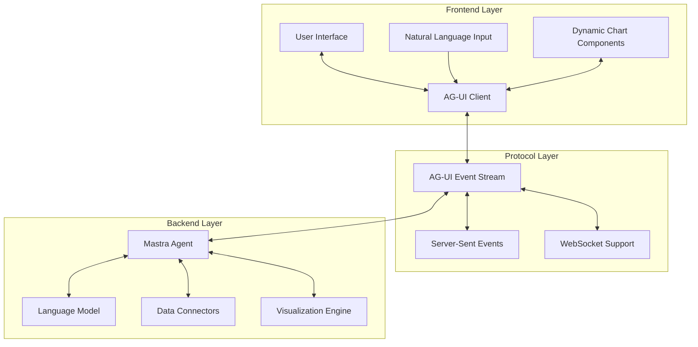

# Generative UI Analysis App Documentation

## Overview

This repository provides a complete framework for building generative UI analysis applications using the AG-UI protocol. The system enables natural language-driven data analysis with real-time streaming visualizations, making it perfect for business intelligence, data exploration, and analytical applications.

## What is a Generative UI Analysis App?

A generative UI analysis app is an intelligent application that:

1. **Accepts natural language queries** from users about their data
2. **Dynamically generates appropriate visualizations** based on query intent
3. **Streams results in real-time** using event-based communication
4. **Adapts the UI** based on the analysis context and data characteristics
5. **Provides explanatory insights** alongside visualizations

## Architecture Overview



## Key Components

### 1. AG-UI Protocol Foundation

The system is built on the AG-UI protocol, which provides:

- **Event-driven communication** between frontend and backend
- **Standardized event types** for different interaction patterns
- **Streaming capabilities** for real-time updates
- **Tool call system** for dynamic UI generation

#### Core Event Types Used:

- `RUN_STARTED` / `RUN_FINISHED` - Lifecycle management
- `TEXT_MESSAGE_CONTENT` - Streaming analysis insights
- `TOOL_CALL_START` / `TOOL_CALL_ARGS` / `TOOL_CALL_END` - Visualization generation
- `STATE_SNAPSHOT` / `STATE_DELTA` - UI state synchronization

### 2. Natural Language Processing Pipeline

The system includes a sophisticated NLP pipeline that:

- **Analyzes query intent** (comparison, trends, correlation, etc.)
- **Extracts entities** (metrics, dimensions, filters)
- **Maps natural language to data operations**
- **Generates appropriate visualization types**

### 3. Multi-Source Data Integration

Supports various data sources:

- **CSV files** - Direct file upload and processing
- **PDF documents** - Text and table extraction
- **PostgreSQL** - Relational database queries
- **MongoDB** - NoSQL document queries
- **Supabase** - Cloud database integration

### 4. Intelligent Visualization Engine

Automatically selects and generates:

- **Standard charts** (bar, line, pie, scatter)
- **Geographic maps** with data overlays
- **Interactive tables** with sorting/filtering
- **Custom visualizations** based on data characteristics

## Implementation Guide

### Setting Up the Backend Agent

The core of the system is a Mastra-based agent that processes queries:

```typescript
// Example agent implementation structure
export class BIAgent extends AbstractAgent {
  async run(input: RunInput): Promise<Observable<AGUIEvent>> {
    return new Observable((observer) => {
      this.processQuery(input.query, observer);
    });
  }

  private async processQuery(query: string, observer: Observer<AGUIEvent>) {
    // 1. Emit run started
    observer.next({ type: 'RUN_STARTED', runId: this.runId });
    
    // 2. Analyze query intent
    const intent = await this.analyzeIntent(query);
    
    // 3. Fetch relevant data
    const data = await this.fetchData(intent);
    
    // 4. Generate insights
    const insights = await this.generateInsights(data, intent);
    
    // 5. Stream text analysis
    observer.next({
      type: 'TEXT_MESSAGE_CONTENT',
      content: insights
    });
    
    // 6. Generate visualization
    const vizConfig = this.createVisualization(data, intent);
    
    // 7. Stream visualization via tool calls
    observer.next({
      type: 'TOOL_CALL_START',
      toolName: 'render_chart',
      args: vizConfig
    });
    
    observer.next({ type: 'RUN_FINISHED', runId: this.runId });
  }
}
```

### Frontend Integration

The frontend uses AG-UI client libraries to handle events:

```typescript
// React component example
function AnalysisApp() {
  const [messages, setMessages] = useState([]);
  const [visualizations, setVisualizations] = useState([]);
  
  const handleQuery = async (query: string) => {
    const eventStream = await agUIClient.run({ query });
    
    eventStream.subscribe((event) => {
      switch (event.type) {
        case 'TEXT_MESSAGE_CONTENT':
          setMessages(prev => [...prev, event.content]);
          break;
          
        case 'TOOL_CALL_START':
          if (event.toolName === 'render_chart') {
            setVisualizations(prev => [...prev, event.args]);
          }
          break;
      }
    });
  };
  
  return (
    <div>
      <NaturalLanguageInput onSubmit={handleQuery} />
      <MessageStream messages={messages} />
      <VisualizationGrid visualizations={visualizations} />
    </div>
  );
}
```

## Usage Patterns

### 1. Exploratory Data Analysis

**User Query**: *"Show me the sales trends over the last 6 months"*

**System Response**:
1. Analyzes intent: trend analysis over time
2. Fetches sales data with temporal filtering
3. Generates line chart with trend analysis
4. Provides insights: "Sales show 15% growth with peak in December"

### 2. Comparative Analysis

**User Query**: *"Compare revenue by region and show the top 5 performers"*

**System Response**:
1. Analyzes intent: comparison + ranking
2. Aggregates revenue by region
3. Generates bar chart with top 5 regions
4. Provides insights: "West Coast leads with $2.3M, 23% above average"

### 3. Correlation Discovery

**User Query**: *"Is there a relationship between marketing spend and customer acquisition?"*

**System Response**:
1. Analyzes intent: correlation analysis
2. Fetches both metrics with temporal alignment
3. Generates scatter plot with correlation coefficient
4. Provides insights: "Strong positive correlation (r=0.78) suggests effective marketing ROI"

### 4. Geographic Analysis

**User Query**: *"Show customer distribution on a map with revenue overlay"*

**System Response**:
1. Analyzes intent: geographic visualization
2. Fetches customer locations and revenue data
3. Generates choropleth map with revenue heatmap
4. Provides insights: "Urban centers account for 67% of total revenue"

## Advanced Features

### 1. Multi-Step Analysis

The system supports complex, multi-step analytical workflows:

```typescript
// Example: Drill-down analysis
"Show quarterly sales" → Bar chart by quarter
"Break down Q4 by month" → Detailed monthly view
"Show Q4 by product category" → Category breakdown
"Which products drove Q4 growth?" → Product-level analysis
```

### 2. Contextual Follow-ups

The system maintains conversation context:

```typescript
// Context-aware queries
User: "Show me sales by region"
System: [Displays regional sales chart]

User: "Now show that by product category"
System: [Understands "that" refers to sales data, shows category breakdown]

User: "What's driving the spike in the West region?"
System: [Analyzes West region specifically for anomalies]
```

### 3. Adaptive Visualizations

The system automatically adapts visualizations based on:

- **Data characteristics** (volume, distribution, types)
- **User intent** (comparison, trend, correlation)
- **Device constraints** (mobile vs desktop)
- **Accessibility needs** (color-blind friendly palettes)

### 4. Real-time Data Streaming

For live data sources, the system supports:

- **Incremental updates** to existing visualizations
- **Automatic refresh** based on data change detection
- **Progressive loading** for large datasets
- **Optimistic updates** with conflict resolution

## Data Source Integration

### CSV File Processing

```typescript
// Automatic schema detection and processing
const csvProcessor = new CSVDataSource({
  autoDetectTypes: true,
  headerRow: true,
  encoding: 'utf-8'
});

// Natural language queries work directly
"Show me the top 10 customers by revenue from the sales.csv file"
```

### Database Connections

```typescript
// PostgreSQL integration
const pgSource = new PostgreSQLDataSource({
  host: process.env.PG_HOST,
  database: process.env.PG_DATABASE,
  // Secure credential management
});

// Natural language to SQL translation
"Show monthly active users from the analytics database"
// Translates to: SELECT DATE_TRUNC('month', created_at), COUNT(DISTINCT user_id) FROM users...
```

### API Integration

```typescript
// REST API data sources
const apiSource = new APIDataSource({
  baseURL: 'https://api.example.com',
  authentication: 'bearer',
  rateLimiting: true
});

// Automatic API exploration and query generation
"Get customer satisfaction scores from the support API"
```

## Deployment Options

### 1. Development Setup

```bash
# Clone the repository
git clone https://github.com/ag-ui-protocol/ag-ui.git
cd ag-ui

# Install dependencies
pnpm install

# Set up environment
cp .env.example .env
# Add your API keys and database connections

# Start development server
pnpm run dev
```

### 2. Production Deployment

```dockerfile
# Docker deployment example
FROM node:18-alpine

WORKDIR /app
COPY package*.json ./
RUN npm ci --only=production

COPY . .
RUN npm run build

EXPOSE 3000
CMD ["npm", "start"]
```

### 3. Cloud Deployment

The system supports deployment on:

- **Vercel** - Serverless frontend with API routes
- **AWS** - ECS/Lambda with RDS integration
- **Google Cloud** - Cloud Run with BigQuery
- **Azure** - Container Instances with Cosmos DB

## Security Considerations

### 1. Data Privacy

- **Query sanitization** prevents SQL injection
- **Data masking** for sensitive information
- **Access control** based on user roles
- **Audit logging** for compliance

### 2. API Security

- **Rate limiting** prevents abuse
- **Authentication** via JWT or OAuth
- **CORS configuration** for cross-origin requests
- **Input validation** for all user inputs

### 3. Data Source Security

- **Encrypted connections** to databases
- **Credential rotation** for API keys
- **Network isolation** for sensitive data
- **Backup encryption** for data at rest

## Customization and Extension

### 1. Custom Visualization Types

```typescript
// Add new visualization types
class CustomHeatmapTool extends VisualizationTool {
  name = 'render_heatmap';
  
  async execute(data: any[], config: HeatmapConfig) {
    return {
      type: 'heatmap',
      data: this.processHeatmapData(data),
      config: config
    };
  }
}
```

### 2. Domain-Specific Agents

```typescript
// Create specialized agents for different domains
class FinancialAnalysisAgent extends BIAgent {
  constructor() {
    super();
    this.addDomainKnowledge('financial-metrics');
    this.addSpecializedTools(['risk-analysis', 'portfolio-optimization']);
  }
}

class MarketingAnalysisAgent extends BIAgent {
  constructor() {
    super();
    this.addDomainKnowledge('marketing-metrics');
    this.addSpecializedTools(['funnel-analysis', 'cohort-analysis']);
  }
}
```

### 3. Custom Data Connectors

```typescript
// Implement custom data source connectors
class SalesforceConnector extends DataSource {
  async connect(credentials: SalesforceCredentials) {
    // Implement Salesforce API connection
  }
  
  async query(nlQuery: string): Promise<QueryResult> {
    // Translate natural language to SOQL
    const soql = await this.translateToSOQL(nlQuery);
    return this.executeSalesforceQuery(soql);
  }
}
```

## Performance Optimization

### 1. Query Optimization

- **Query caching** for repeated analyses
- **Incremental loading** for large datasets
- **Parallel processing** for multi-source queries
- **Smart aggregation** to reduce data transfer

### 2. Visualization Performance

- **Virtual scrolling** for large tables
- **Canvas rendering** for high-density charts
- **Progressive enhancement** for complex visualizations
- **Responsive design** for mobile devices

### 3. Real-time Updates

- **WebSocket connections** for live data
- **Differential updates** to minimize bandwidth
- **Client-side caching** for improved responsiveness
- **Background processing** for heavy computations

## Monitoring and Analytics

### 1. Usage Analytics

- **Query pattern analysis** to improve NLP
- **Visualization effectiveness** metrics
- **User engagement** tracking
- **Performance monitoring** for optimization

### 2. Error Handling

- **Graceful degradation** when services are unavailable
- **User-friendly error messages** for failed queries
- **Automatic retry** for transient failures
- **Fallback visualizations** when primary options fail

## Best Practices

### 1. Query Design

- **Start simple** and progressively add complexity
- **Use domain-specific terminology** that users understand
- **Provide query examples** and suggestions
- **Support natural follow-up questions**

### 2. Visualization Selection

- **Match chart type to data story**
- **Consider user's analytical intent**
- **Optimize for the target audience**
- **Provide multiple visualization options**

### 3. User Experience

- **Provide immediate feedback** during processing
- **Show progress indicators** for long-running queries
- **Enable easy sharing** of insights and visualizations
- **Support export** in multiple formats

## Conclusion

This AG-UI-based generative UI analysis app provides a powerful foundation for building intelligent data analysis applications. The combination of natural language processing, real-time streaming, and dynamic visualization generation creates an intuitive and powerful user experience.

The modular architecture makes it easy to:

- **Extend with new data sources**
- **Add custom visualization types**
- **Integrate with existing systems**
- **Deploy across different environments**

Whether you're building a business intelligence dashboard, a data exploration tool, or a specialized analytical application, this framework provides the building blocks you need to create engaging, intelligent user experiences.

For more information and examples, explore the repository structure and refer to the implementation guides in each component directory.